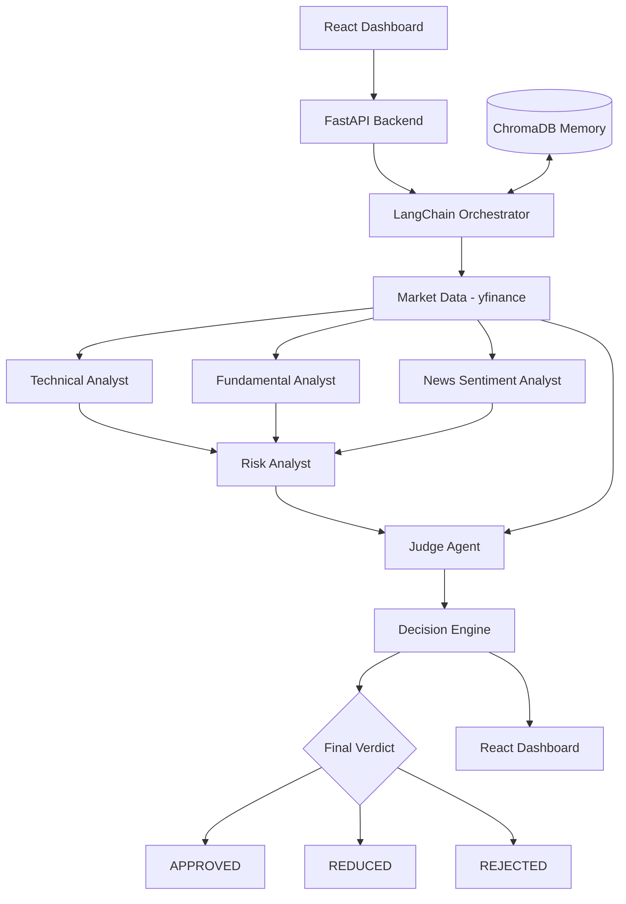

# 🏛️ Hermes
### Multi-Agent AI Framework for Quantitative Trading

Hermes combines AI agents, quantitative analysis, and risk validation to evaluate trading opportunities. A dedicated **Judge Agent** validates market data, evaluates risk, and assigns a final trading verdict.

## 🚀 Key Features

- **Multi-Agent Analysis:** Technical, Fundamental, News Sentiment, and Risk Analysts.
- **Judge Agent:** Independently validates proposed trading decisions.
- **Risk Management:** Drawdown checks, Sharpe ratio evaluation, and position sizing.
- **Quantitative Backtesting:** Uses VectorBT to evaluate historical strategies.
- **Market Data Validation:** Checks financial data and technical indicators.
- **Vector Memory:** Uses ChromaDB to store and retrieve historical context.

## 🏗️ System Architecture



## 🧠 Decision Engine

Hermes calculates a weighted score:

\[
S_{\text{final}} =
0.40S_{\text{risk}} +
0.30S_{\text{accuracy}} +
0.15S_{\text{reasoning}} +
0.15S_{\text{overall}}
\]

| Component | Weight |
|---|---:|
| Risk | 40% |
| Accuracy | 30% |
| Reasoning | 15% |
| Overall Consensus | 15% |

### Decision Rules

| Condition | Verdict | Allocation |
|---|---|---:|
| Final score ≥ 7 and risk score ≥ 5 | APPROVED | 10–15% |
| Final score ≥ 5 and risk score ≥ 5 | REDUCED | 5% |
| Final score < 5 or risk score < 5 | REJECTED | 0% |

## 🛡️ Risk Validation

- Rejects proposals that breach the configured −30% maximum drawdown threshold.
- Reduces position sizing when the Sharpe ratio falls below 1.0.
- Validates financial figures against available market data.
- Uses independent risk checks before assigning a verdict.

## 📊 Validation Example

A reported historical META evaluation produced:

- Maximum drawdown: **−42.26%**
- Risk score: **2.0**
- Final score: **4.78**
- Verdict: **REJECTED**

This illustrates the configured rejection rules; it does not guarantee future loss prevention.

## 🧰 Tech Stack

- **Language:** Python
- **Backend:** FastAPI
- **Frontend:** React
- **AI:** Gemini 2.5 Flash, LangChain
- **Backtesting:** VectorBT
- **Market Data:** yfinance
- **Vector Memory:** ChromaDB
- **Deployment:** AWS EC2

## ⚙️ Setup

```bash
git clone <YOUR_REPOSITORY_URL>
cd hermes
```

Set up the backend environment and install its dependencies:

```bash
cd backend
python -m venv venv
pip install -r requirements.txt
```

Configure your Gemini API key in the environment, then start FastAPI using your application's entry point.

Run the React frontend separately using `npm install` and `npm run dev`.

*Adjust the commands to match your actual project structure.*

## ⚠️ Disclaimer

Hermes is an experimental quantitative trading research project. Backtested results do not guarantee future returns. Use paper trading and appropriate risk controls before considering live trading.

## 📄 License

MIT License.
